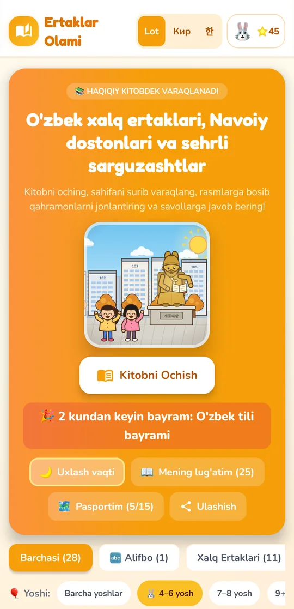
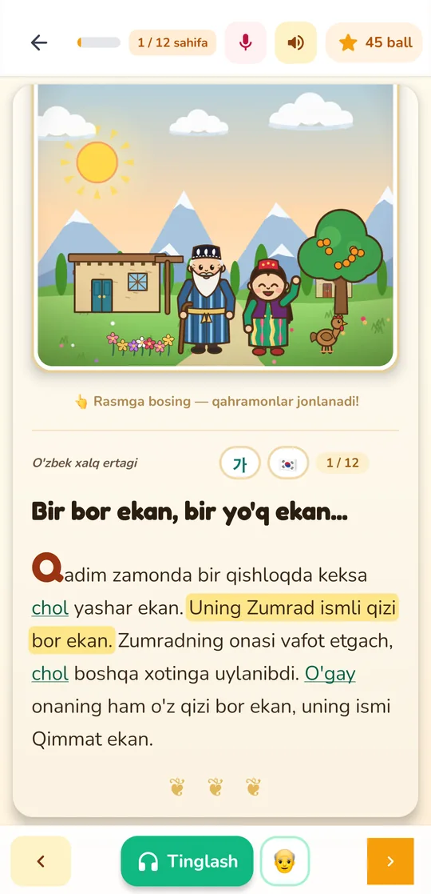
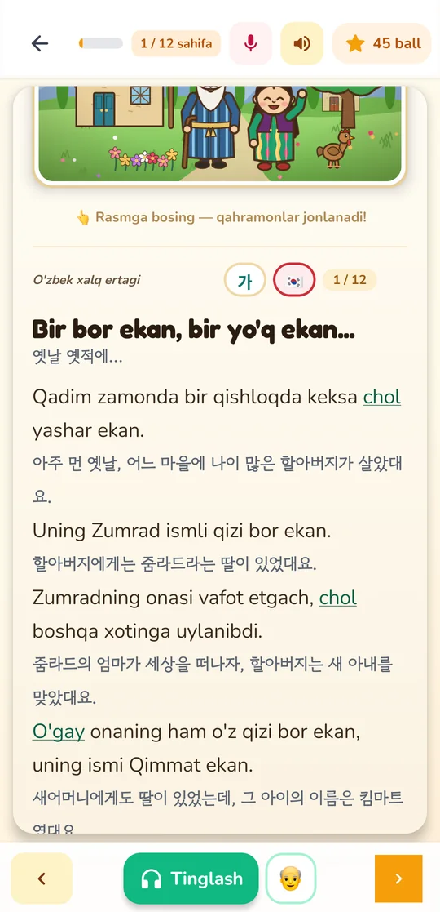
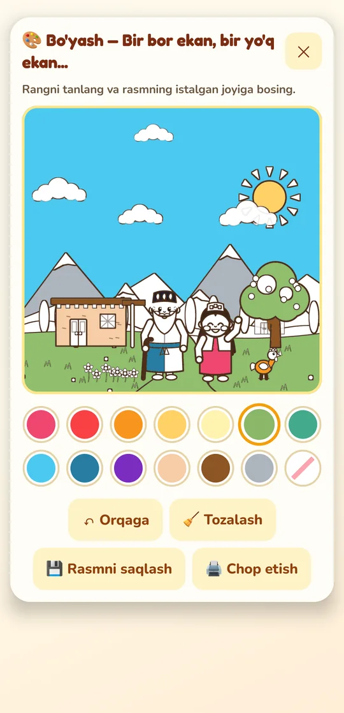
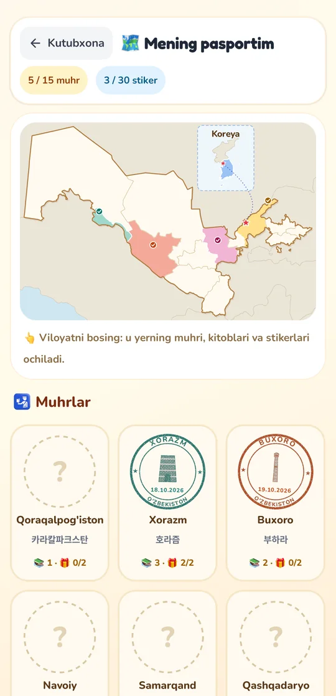
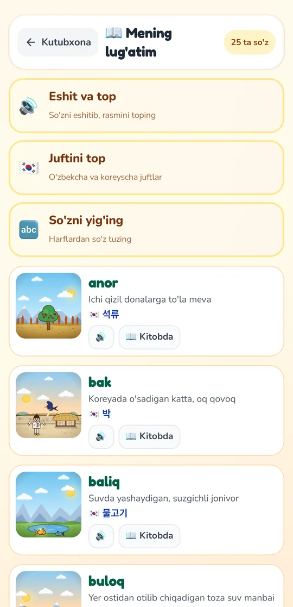
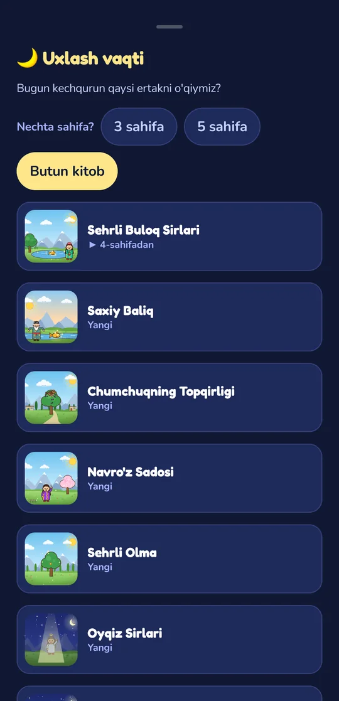
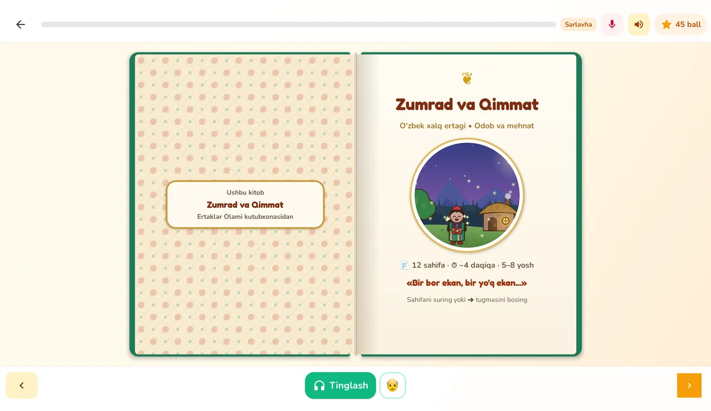
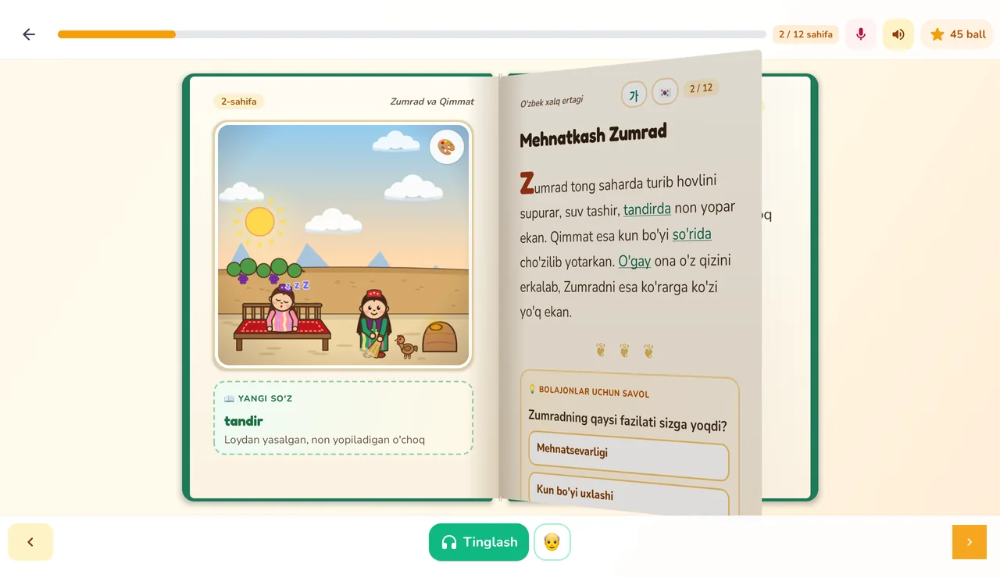

# Ertaklar Olami

An interactive picture book of Uzbek tales for children, for Android phones and tablets.
28 illustrated books with questions, games, a Korean helper for families in Korea,
and grandparents' voices reading aloud. Everything stays on the device: no accounts,
no internet, no ads.

## Download

**[⬇ Download ErtaklarOlami.apk](https://github.com/8ekh20d/ErtaklarOlami/releases/latest/download/ErtaklarOlami.apk)**
(Android 7.0 or newer)

1. Open the link on the phone and download the file.
2. Open it. If asked, allow installing apps from this source.
3. Tap **Install**.

## Screenshots

| Library | Reading aloud | Korean helper |
|:---:|:---:|:---:|
|  |  |  |
| **Colouring** | **Culture passport** | **My dictionary** |
|  |  |  |

| Bedtime | Tablet: the book lies open |
|:---:|:---:|
|  | <br> |

## What's inside

- **Books** — folk tales, classics, Navoiy, short pieces and the Uzbek alphabet, by age shelf.
- **Reading** — questions with points, new words, Latin or Cyrillic script, menus in Korean.
- **Family voices** — grown-ups record the pages; the book then reads along and lights up each sentence.
- **Play corner** — colouring, story order, find the differences, letter tracing, word games.
- **Passport** — finishing a book stamps its region on the map of Uzbekistan; points buy stickers.
- **Bedtime** — a calm, dark reader for a few pages, then good night.
- **Tablets** — a two-page spread with pages that turn like paper.

## Build

Open the project in Android Studio, or run:

```bash
./gradlew installDebug
```

Requires JDK 17. Kotlin, Jetpack Compose, Hilt, Room, Navigation, Coil, Media3.

## Licences

Fonts (Fredoka, Nunito, Gowun Dodum) are under the SIL Open Font License, emoji in the
pictures are Twemoji (CC BY 4.0), the icon's book is from Font Awesome (CC BY 4.0) and the
map comes from Natural Earth. Full texts are in `app/src/main/assets/licenses` and in the
app under **📜 Litsenziyalar**.
